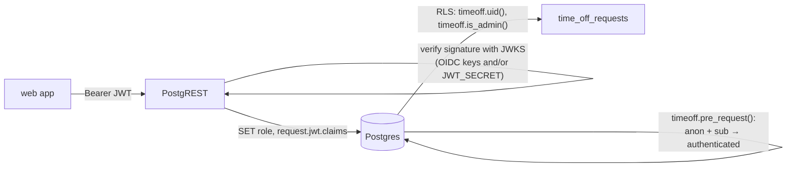

# PostgREST time-off playground

A small monorepo for trying out PostgREST with row level security and optional OIDC:

- **`infra/docker`**: Postgres 18 + PostgREST 16 via Docker Compose, with a time-off schema, RLS, and claim-based admin rules. Out of the box it signs users in through a local OIDC test server.
- **`apps/web`**: a TanStack Start app that works as a debugger. Sign in with OIDC or a pasted JWT, see what Postgres thinks of your token, create and delete time-off requests, and inspect every call made to PostgREST.

Tooling: TypeScript 7, [Vite+](https://viteplus.dev) (`vp`) for dev, build, lint, format and tasks, and pnpm workspaces.

```
.
├── apps/web                 TanStack Start debugger
├── db/                      the database: roles, schema + RLS, admin rules, sample data
├── scripts/                 setup-postgrest.sh (PostgREST roles), setup-database.sh (tables + RLS)
├── infra/auth0              Auth0 roles Action + setup script (optional)
├── infra/docker
│   ├── compose.yaml
│   ├── .env.example         all settings (shared with apps/web)
│   └── jwks/build-jwks.mjs  builds the key set PostgREST verifies tokens with
├── Dockerfile               production image of apps/web (needs POSTGREST_BASE_URI)
├── vite.config.ts           Vite+ lint/format/task config for the whole repo
├── jsdoc.json               jsdoc-lint settings
├── AGENTS.md                validation and comment rules for coding agents
└── pnpm-workspace.yaml
```

## Quick start

Requirements: Node 22.18+, pnpm 10, Docker.

```bash
pnpm install
```

```bash
cp infra/docker/.env.example infra/docker/.env
```

```bash
pnpm infra:up
```

```bash
pnpm dev
```

Open http://localhost:5173 and click **Sign in with OIDC**. That takes you to the local OIDC test server at http://localhost:8090, whose login page accepts any subject and any claims JSON. The OIDC tab lists ready-made subjects and claims for the seeded users (Alice, Bob) and for two admins. PostgREST itself listens on http://localhost:3000.

Other commands:

| Command                   | What it does                                                                                                                           |
| ------------------------- | -------------------------------------------------------------------------------------------------------------------------------------- |
| `pnpm check`              | everything CI should run: `vp check` (Oxfmt formatting, type-aware Oxlint), `jsdoc-lint`, and the type check                           |
| `pnpm check:fix`          | the same, after applying formatter and lint fixes                                                                                      |
| `pnpm lint:jsdoc`         | only `jsdoc-lint`: every top-level declaration needs a multiline JSDoc block (see `AGENTS.md`)                                         |
| `pnpm typecheck`          | `tsc --noEmit` (TypeScript 7) in every package                                                                                         |
| `pnpm build`              | production build (`apps/web/.output`; run with `PORT=5173 pnpm --filter web start`, since the default port 3000 is taken by PostgREST) |
| `pnpm infra:logs`         | follow the container logs                                                                                                              |
| `pnpm infra:down`         | stop the stack                                                                                                                         |
| `pnpm infra:reset`        | stop and delete the database volume; the next `up` starts from an empty database with sample data                                      |
| `pnpm db:setup-postgrest` | create the PostgREST roles in any Postgres database (see [Production database](#production-database))                                  |
| `pnpm db:setup`           | create or update the tables, RLS and admin rules in any Postgres database (see [Production database](#production-database))            |

## Docker image

The [`Dockerfile`](Dockerfile) in the root builds the app into a small production image (Node 24, runs as a non-root user, listens on port 3000). It needs one setting, `POSTGREST_BASE_URI`, the base URI of your PostgREST API; without it the container stops with an error.

```bash
docker build -t timeoff-web .
```

```bash
docker run --rm -p 8080:3000 -e POSTGREST_BASE_URI=https://postgrest.example.com timeoff-web
```

Then open http://localhost:8080. Other settings are optional:

| Variable                                                                                              | When                                                                                                        |
| ----------------------------------------------------------------------------------------------------- | ----------------------------------------------------------------------------------------------------------- |
| `APP_URL`, `OIDC_ISSUER`, `OIDC_CLIENT_ID`, `OIDC_CLIENT_SECRET`, `OIDC_SCOPES`, `OIDC_FORWARD_TOKEN` | to enable "Sign in with OIDC"; `APP_URL` is the public URL, used for the `<APP_URL>/auth/callback` redirect |
| `ADMIN_EMAILS`, `ADMIN_EMAIL_DOMAINS`, `ADMIN_GROUPS`, …                                              | only to show the current rules in the "How to become an admin" panel                                        |
| `PORT`                                                                                                | to listen on another port inside the container (default 3000)                                               |

Behind an [authenticating reverse proxy](#behind-an-authenticating-reverse-proxy), `POSTGREST_BASE_URI` is all it takes. To use it with the local Docker stack, point it at the host: `-e POSTGREST_BASE_URI=http://host.docker.internal:3000`.

In development the app falls back to `http://localhost:<POSTGREST_PORT>`; you can also set `POSTGREST_BASE_URI` in `apps/web/.env`.

## How auth works



1. **Verification.** PostgREST reads its key set from `/jwt/jwks.json`, written at startup by the `jwks` service. It contains your provider's signing keys when `OIDC_ISSUER` is set, plus an HS256 key when `JWT_SECRET` is set (PostgREST's classic shared-secret setup, for tokens you sign yourself). That is what makes OIDC optional: same compose file, a couple of variables.
2. **Role.** The anonymous role (`anon`) has no access to anything in the API; signed-in requests run as `authenticated`. A token can name that role in a `role` claim. OIDC tokens normally don't, so PostgREST starts them as `anon`, and the `timeoff.pre_request()` hook (`PGRST_DB_PRE_REQUEST`) switches any request with a verified `sub` to `authenticated`.
3. **Row level security.** Every request row stores `user_id = timeoff.uid()` (the `sub` claim). Policies let you see, edit and delete your own rows. You can only create them as `pending` and for yourself, and you can't approve them. Admins pass every policy. On top of that, restrictive policies on both tables reject any request without a verified `sub` with HTTP 401 (`PT401`), whatever the other policies say; `whoami()` and the `admin_rules` view do the same.
4. **Admins.** `timeoff.is_admin()` checks the token's claims against `timeoff.admin_rules`. Matching any enabled rule makes you an admin.

## Admin rules

Set them in `infra/docker/.env`. They are rewritten on every `pnpm infra:up`, so there's no need to reset the database. (In production, [`pnpm db:setup`](#production-database) asks for them.)

```bash
ADMIN_EMAILS=boss@example.com,hr@example.com        # $.email equals …
ADMIN_EMAIL_DOMAINS=hr.example.com                  # $.email ends with @…
ADMIN_GROUPS=timeoff-admins                         # any value of the groups claim equals …
ADMIN_GROUPS_CLAIM=$.groups                         # e.g. $.realm_access.roles for Keycloak
ADMIN_CLAIM_RULES=$.department|equals|HR;$.roles|equals|admin
ADMIN_REQUIRE_EMAIL_VERIFIED=false                  # true: email rules need email_verified=true
```

Claims are addressed with SQL/JSON paths, so namespaced claims work too: `$."https://example.com/roles"`. Arrays are unwrapped, so "user is in group X" is just `equals`. Operators are `equals`, `ends_with`, `starts_with`, `contains` and `matches` (case-insensitive regex), and every comparison ignores case.

You can also add rules by hand. These are kept across restarts:

```sql
insert into timeoff.admin_rules (claim, operator, value, description)
values ('$.email', 'ends_with', '@acme.test', 'everyone at Acme');
```

Admins can read the rules (and see which ones match them) through `GET /admin_rules`.

## OIDC

PostgREST trusts any token signed by your OIDC provider's keys, and the web app signs you in with the authorization code flow (PKCE). Three setups are documented below: the [local test server](#local-oidc-test-server-default), which is the default, [Auth0](#auth0), and running [behind an authenticating reverse proxy](#behind-an-authenticating-reverse-proxy) that handles the login for the app. Any other provider works the same way with the settings in this table (all in `infra/docker/.env`):

| Variable                                | Used by   | Notes                                                                                 |
| --------------------------------------- | --------- | ------------------------------------------------------------------------------------- |
| `OIDC_ISSUER`                           | both      | e.g. `https://login.example.com/realms/acme`                                          |
| `OIDC_AUDIENCE`                         | PostgREST | expected `aud`, usually the client id. Empty skips the check                          |
| `OIDC_JWKS_URI`                         | jwks      | only needed if discovery from inside Docker doesn't work (an issuer on `localhost`)   |
| `OIDC_CLIENT_ID` / `OIDC_CLIENT_SECRET` | web       | secret is optional (public client with PKCE)                                          |
| `OIDC_SCOPES`                           | web       | default `openid profile email`                                                        |
| `OIDC_FORWARD_TOKEN`                    | web       | `id_token` (default) or `access_token`, if your provider issues JWT access tokens     |
| `APP_URL`                               | web       | default `http://localhost:5173`. Register `<APP_URL>/auth/callback` as a redirect URI |

After changing any of them, run `pnpm infra:up` and restart `pnpm dev`. Make sure the claims your admin rules use (email, groups, roles, …) are actually in the token the app forwards.

**Running without OIDC:** remove `COMPOSE_PROFILES`, leave `OIDC_ISSUER` empty and set `JWT_SECRET` (at least 32 characters). Then sign tokens with that secret yourself and use the app's Paste JWT tab.

**Key rotation.** PostgREST keeps the key set in memory. After your provider rotates keys, run `pnpm infra:up` again: `jwks` fetches the new keys and `db-setup` tells PostgREST to reload them (`NOTIFY pgrst, 'reload config'`).

### Local OIDC test server (default)

The `oidc-mock` profile runs [navikt/mock-oauth2-server](https://github.com/navikt/mock-oauth2-server) on port 8090. It has no user accounts: its login page lets you type any subject (`sub`) and any extra claims, so you can try every admin rule without setting anything up. Its tokens are RS256-signed and verified by PostgREST exactly like a real provider's.

1. Use the default settings. `.env.example` already contains:

   ```bash
   COMPOSE_PROFILES=oidc-mock
   OIDC_ISSUER=http://localhost:8090/default
   OIDC_JWKS_URI=http://mock-oidc:8080/default/jwks
   OIDC_CLIENT_ID=postgrest-debugger
   OIDC_AUDIENCE=postgrest-debugger
   ```

   `OIDC_JWKS_URI` is set because `localhost` inside the `jwks` container is the container itself, so it fetches the keys through the Compose service name instead.

2. Start everything:

   ```bash
   pnpm infra:up
   ```

   ```bash
   pnpm dev
   ```

3. Open http://localhost:5173 and click **Sign in with OIDC**. On the test server's page, enter a subject and claims JSON, then click **Sign-in**. The OIDC tab in the app has copy buttons for these:

   | Who   | Subject      | Claims                                                                                   | Result                                 |
   | ----- | ------------ | ---------------------------------------------------------------------------------------- | -------------------------------------- |
   | Alice | `user-alice` | `{"email":"alice@example.com","name":"Alice Martin","groups":["staff"]}`                 | regular user, sees her seeded requests |
   | Bob   | `user-bob`   | `{"email":"bob@example.com","name":"Bob Janssens","groups":["staff"]}`                   | regular user                           |
   | Dave  | `user-dave`  | `{"email":"dave@example.com","name":"Dave Peeters","groups":["staff","timeoff-admins"]}` | admin through `ADMIN_GROUPS`           |
   | Ada   | `user-admin` | `{"email":"admin@example.com","name":"Ada Admin"}`                                       | admin through `ADMIN_EMAILS`           |

   Any other subject works too; it starts with no requests. To try a new rule, add it to `.env` (for example `ADMIN_EMAIL_DOMAINS=hr.example.com`), run `pnpm infra:up`, and sign in with matching claims (`{"email":"x@hr.example.com"}`).

Tokens from the test server are valid for an hour. When yours expires, sign out and sign in again.

### Auth0

You need an Auth0 tenant and the [Auth0 CLI](https://github.com/auth0/auth0-cli). Everything below can also be done in the Auth0 dashboard; the matching screen is mentioned for each step.

```bash
brew tap auth0/auth0-cli && brew install auth0
```

1. **Log in and find your tenant domain** (for example `acme.eu.auth0.com`):

   ```bash
   auth0 login
   ```

   ```bash
   auth0 tenants list
   ```

2. **Create the application.** It must be a Regular Web Application, because the web app exchanges the code on the server with a client secret. Dashboard: _Applications → Create Application → Regular Web Applications_, then set _Allowed Callback URLs_ and _Allowed Logout URLs_.

   ```bash
   auth0 apps create \
     --name "PostgREST time-off debugger" \
     --type regular \
     --callbacks http://localhost:5173/auth/callback \
     --logout-urls http://localhost:5173 \
     --reveal-secrets
   ```

   Note the **Client ID** and **Client Secret** in the output.

3. **Point `infra/docker/.env` at Auth0.** Comment out the test server and fill in your tenant and app:

   ```bash
   # COMPOSE_PROFILES=oidc-mock
   OIDC_ISSUER=https://acme.eu.auth0.com/
   OIDC_JWKS_URI=
   OIDC_CLIENT_ID=<client id>
   OIDC_CLIENT_SECRET=<client secret>
   OIDC_AUDIENCE=<client id>
   OIDC_SCOPES=openid profile email
   OIDC_FORWARD_TOKEN=id_token
   ```

   Keep `OIDC_FORWARD_TOKEN=id_token`. Auth0 only issues JWT access tokens when an API `audience` is requested, which this app doesn't do. The id_token's `aud` is your client ID, hence `OIDC_AUDIENCE`.

4. **Choose who is an admin.** The simplest option is by email, since Auth0 includes `email` and `email_verified` in the id_token:

   ```bash
   ADMIN_EMAILS=you@acme.com
   ADMIN_REQUIRE_EMAIL_VERIFIED=true
   ```

   Users of a database connection must verify their email first; social logins such as Google arrive verified.

5. **Optional: admins by Auth0 role.** Auth0 doesn't put roles in tokens by default, so a post-login Action adds them as a custom claim. Custom claims should be namespaced with a URL; `https://timeoff.example/roles` is just a name and doesn't need to exist.

   Create the role and assign it to a user (dashboard: _User Management → Roles_):

   ```bash
   auth0 roles create --name timeoff-admins --description "Can see and delete everyone's time off"
   ```

   ```bash
   auth0 users search --query email:"you@acme.com"
   ```

   ```bash
   auth0 users roles assign "<user-id>" --roles "<role-id>"
   ```

   Then add the Action that puts the roles in the id_token ([`infra/auth0/add-roles-to-id-token.js`](infra/auth0/add-roles-to-id-token.js)). This script creates it, waits for Auth0 to build it, deploys it, and adds it to the end of the post-login flow (needs `jq`):

   ```bash
   ./infra/auth0/setup-roles-action.sh
   ```

   It is safe to re-run, for example after editing the Action's code. It finds the Action by name and updates that same one, and it only touches the login flow when the Action isn't in it yet. Other Actions in the flow are kept, in their order. Pass `--tenant <domain>` to target a tenant other than the CLI's active one. Dashboard alternative: _Actions → Library → Create Action_, then drag it into _Actions → Triggers → post-login_.

   Then match the claim in `infra/docker/.env`. The single quotes keep the double quotes in the JSON path:

   ```bash
   ADMIN_GROUPS=timeoff-admins
   ADMIN_GROUPS_CLAIM='$."https://timeoff.example/roles"'
   ```

6. **Restart and sign in:**

   ```bash
   pnpm infra:up
   ```

   ```bash
   pnpm dev
   ```

   `pnpm infra:logs` should show the `jwks` service fetching Auth0's keys (`oidc: N signing key(s) from https://acme.eu.auth0.com/.well-known/jwks.json`). Open http://localhost:5173 and click **Sign in with OIDC**.

**Switching users.** Signing out of the app keeps your Auth0 session, so the next sign-in goes straight back in as the same user. To log out of Auth0 too, open `https://<tenant-domain>/v2/logout?client_id=<client id>&returnTo=http://localhost:5173`.

**Troubleshooting**

- _Callback URL mismatch_ on the Auth0 page: the app's _Allowed Callback URLs_ must contain exactly `<APP_URL>/auth/callback`.
- `PGRST303 JWT not in audience`: `OIDC_AUDIENCE` must be the client ID.
- `PGRST301 No suitable key`: the `jwks` service didn't fetch Auth0's keys. Check `OIDC_ISSUER` and the `jwks` logs, then run `pnpm infra:up` again.
- Not an admin when you expect to be: open _Token claims_ in the Identity panel and check that the email or roles claim is there. Role changes only show up after signing in again.

### Behind an authenticating reverse proxy

If the app runs behind a reverse proxy that does the OIDC login itself (oauth2-proxy and compatible proxies), the app doesn't need its own OIDC setup. The proxy passes the user's id_token on every request:

```
X-Auth-Request-Token: eyJhbGciOiJSUzI1NiIs…
X-Auth-Request-User: jane@acme.io
X-Forwarded-User: jane@acme.io
```

When `X-Auth-Request-Token` is present, the app:

- sends that token to PostgREST instead of using its own session. The header is read on every request, so a token the proxy refreshes is picked up immediately.
- hides the OIDC and Paste JWT sign-in and the sign-out button, because the proxy owns the session.
- shows who you're signed in as (from the token's claims, falling back to `X-Auth-Request-User`), plus a **View token** button. It opens a dialog with the claims, the header, the proxy's `X-Auth-Request-*` / `X-Forwarded-*` headers and the raw token.

PostgREST still has to trust the proxy's identity provider. Open **View token**, take `iss` and `aud`, and set them in `infra/docker/.env`:

```bash
# COMPOSE_PROFILES=oidc-mock
OIDC_ISSUER=<iss from the token, e.g. https://identity.example.com>
OIDC_AUDIENCE=<aud from the token, the proxy's client id>
OIDC_JWKS_URI=
# The app does no OIDC login of its own here, so these can stay empty:
OIDC_CLIENT_ID=
OIDC_CLIENT_SECRET=
```

Then run `pnpm infra:up`. Admin rules work as usual against the token's claims (for example `ADMIN_EMAILS`, or `ADMIN_EMAIL_DOMAINS=acme.io`).

Trusting the header is safe even if the app can also be reached without the proxy: a forged header only carries a token, and PostgREST rejects any token that isn't signed by `OIDC_ISSUER`'s keys or doesn't have the right `aud`.

## Production database

Setting up Postgres is split into two scripts, so you can skip what's already there:

| Script                                                                                 | What it does                                                                                                                                          | Needs                    |
| -------------------------------------------------------------------------------------- | ----------------------------------------------------------------------------------------------------------------------------------------------------- | ------------------------ |
| [`scripts/setup-postgrest.sh`](scripts/setup-postgrest.sh) (`pnpm db:setup-postgrest`) | creates the roles PostgREST uses: `authenticator` (it logs in as this), `anon` and `authenticated`                                                    | `CREATEROLE`             |
| [`scripts/setup-database.sh`](scripts/setup-database.sh) (`pnpm db:setup`)             | creates or updates the tables, row level security and helper functions, plus (optionally) the admin rules and sample data. Creates no roles or users. | `CREATE` on the database |

Docker runs both on every `pnpm infra:up`, so the production path is exercised in development.

You need **PostgreSQL 14 or newer** and **`psql` 14 or newer** on the machine you run them from (`brew install libpq` or `apt install postgresql-client`). Managed services (RDS, Cloud SQL, Azure, …) work; neither script needs a superuser. Both ask for a connection string (not echoed, since it contains a password), show a summary, and apply everything in one transaction, so a failure changes nothing. Both are safe to run again; that's also how you upgrade.

### New database

```bash
pnpm db:setup-postgrest
```

```bash
pnpm db:setup
```

`db:setup-postgrest` asks for a password for `authenticator`. Leave it empty to generate one, or, when re-running, to keep the current one. A generated password is shown once, inside `PGRST_DB_URI`; store it in your secret manager. A password you typed is never printed.

`db:setup` asks who is an admin (emails, email domains, groups and the claim that holds them, other claim rules, and whether to only trust verified emails) and whether to load sample data (answer no in production). When re-running, it suggests the current admin rules, so pressing Enter keeps them. It ends with the PostgREST settings to use:

```
PGRST_DB_URI=postgres://authenticator:<password>@db.example.com:5432/timeoff?sslmode=require
PGRST_DB_SCHEMAS=public
PGRST_DB_ANON_ROLE=anon
PGRST_DB_PRE_REQUEST=timeoff.pre_request
PGRST_JWT_SECRET=<your OIDC provider's JWKS>
PGRST_JWT_AUD=<the client id your tokens are issued for>
```

### Database that already has PostgREST

The anonymous role (PostgREST's `db-anon-role`) never gets access to the tables; signed-in requests need a role of their own. If the existing PostgREST doesn't have one, `db:setup-postgrest` adds it without touching the roles that are already there. Pass the existing names:

```bash
AUTHENTICATOR_ROLE=postgrest_authenticator ANON_ROLE=web_anon pnpm db:setup-postgrest
```

That creates `authenticated` (it can't log in) and grants it to the login role, so PostgREST can switch to it. Then create the tables with the same anonymous role:

```bash
ANON_ROLE=web_anon pnpm db:setup
```

Finally make sure PostgREST runs signed-in requests as `authenticated`, in one of two ways:

- **A `role` claim in the token** (`"role": "authenticated"`), added by your identity provider. PostgREST switches to the role a token names. This is the only option for managed PostgREST services that don't let you configure a pre-request hook.
- **The pre-request hook** (`db-pre-request = timeoff.pre_request`) for tokens without a `role` claim, as most OIDC tokens are. It switches any request with a verified `sub` to `authenticated`. If PostgREST already has a pre-request function, call this one from it.

PostgREST must also expose `public`, where the tables live. If it exposes several schemas, clients select it with `Accept-Profile` / `Content-Profile`; this app always does.

Everything the app adds lives in `public` (the tables, the `admin_rules` view and `whoami()`) and in `timeoff` (helpers and admin rules). Other schemas, such as an existing `auth` schema, are left alone.

### Managed PostgREST without a role claim (prototype mode)

Some managed PostgREST services can't switch roles on their own: they only use the token's `role` claim, and the identity provider you're tied to may not be able to add one. Every request then runs as the anonymous role, signed in or not. As a stopgap, let that role serve signed-in requests too:

```bash
ANON_ROLE=web_anon AUTHENTICATED_ROLE=web_anon ALLOW_SHARED_ROLE=true ./scripts/setup-database.sh
```

Requests without a verified identity are rejected with 401 ("Sign-in required"): restrictive policies on both tables, `whoami()` and the `admin_rules` view require a token `sub` whatever other policies say, and the regular policies limit everyone to their own rows. One edge case: Postgres only evaluates row security against rows that exist, so reading a table that is completely empty returns `[]` instead of 401 (there is nothing to leak). But row level security is then the only barrier: the anonymous role holds the table privileges. Move to a `role` claim (above) when you can; re-running `db:setup` with separate roles moves the grants and policies over and leaves the anonymous role with nothing.

Point the app at the service with `POSTGREST_BASE_URI=<the service URL>`.

### Tables and RLS only

```bash
./scripts/setup-database.sh --schema-only
```

This creates or updates the tables, row level security and helper functions, and nothing else. It doesn't ask about, add or change admin rules, and loads no data. Without admin rules nobody is an admin until you add rules (re-run without `--schema-only`, or insert into `timeoff.admin_rules`).

### Without prompts

For CI or deploy pipelines, pass `--yes` and provide the answers as variables. Variables that are set win over the current values, and an empty one clears that rule type. `--help` on either script lists every variable.

```bash
DATABASE_URL='postgres://admin:…@db.example.com:5432/timeoff?sslmode=require' \
AUTHENTICATOR_PASSWORD='…' \
./scripts/setup-postgrest.sh --yes
```

```bash
DATABASE_URL='postgres://admin:…@db.example.com:5432/timeoff?sslmode=require' \
ADMIN_EMAIL_DOMAINS=acme.com \
ADMIN_GROUPS=timeoff-admins \
ADMIN_REQUIRE_EMAIL_VERIFIED=true \
./scripts/setup-database.sh --yes
```

### `PGRST_JWT_SECRET` in production

PostgREST can't fetch a JWKS URL; it needs the key set itself. Use your provider's JWKS (`<issuer>/.well-known/openid-configuration` → `jwks_uri`), for example by writing it to a file and setting `PGRST_JWT_SECRET=@/path/jwks.json`. [`infra/docker/jwks/build-jwks.mjs`](infra/docker/jwks/build-jwks.mjs) does exactly that (`OIDC_ISSUER=… JWKS_OUTPUT=./jwks.json node infra/docker/jwks/build-jwks.mjs`). After the provider rotates its keys, refresh the file and reload PostgREST (`NOTIFY pgrst, 'reload config'`).

## The debugger (`apps/web`)

- **Sign in** with OIDC (the default) or by pasting any JWT. Behind an authenticating reverse proxy there is no sign-in at all: the proxy's token is used and can be inspected with **View token** (see [above](#behind-an-authenticating-reverse-proxy)). With the local test server, the OIDC tab suggests subjects and claims that match the seed data and the default admin rules. The token lives in an httpOnly cookie, and all PostgREST calls happen server-side in TanStack Start server functions.
- **Identity** shows the decoded claims next to what Postgres sees: `current_user`, `timeoff.uid()`, `timeoff.email()`, `timeoff.is_admin()` (from `GET /rpc/whoami`).
- **Time off table**: **New request** and each row's **Delete** open modal dialogs; the delete dialog asks for confirmation and says when you are deleting someone else's request as admin. Admins get an Everyone / Only mine toggle, can delete anyone's request, and can book on someone else's behalf.
- **Console**: send any request to PostgREST with (or without) your token. It comes with examples, like trying to approve your own request.
- **Call log**: every request to PostgREST, with headers, body, status and timing.

The app reads `infra/docker/.env` (then `apps/web/.env`) in development, so the OIDC settings are configured in one place.

## Schema

| Object               | Purpose                                                                                 |
| -------------------- | --------------------------------------------------------------------------------------- |
| `time_off_types`     | vacation, sick, personal, parental, unpaid. Readable when signed in, writable by admins |
| `time_off_requests`  | the bookings. `days` counts weekdays (½ for half days)                                  |
| `admin_rules` (view) | the admin rules, visible to admins only                                                 |
| `whoami()`           | the current role, uid, email, admin flag and claims                                     |
| `timeoff.*`          | not exposed: claim helpers, `is_admin()`, `pre_request()`, and the `admin_rules` table  |

The SQL lives in [`db/`](db) and is safe to run again: `pnpm infra:up` (and `pnpm db:setup` in production) creates what's missing and updates functions, views and policies in place, without touching data. To change the schema, edit [`db/schema.sql`](db/schema.sql) so it stays re-runnable (`create … if not exists`, `create or replace`, `drop policy if exists` before `create policy`).

## Things worth knowing

- **401 instead of 403.** PostgREST returns 403 for permission errors only when the JWT named a role. OIDC-style tokens don't, so RLS violations (like approving your own request) come back as `401` with code `42501`. The error body is the real signal.
- **Leave `JWT_SECRET` empty when using OIDC.** Anyone with the secret can sign tokens for any user, and PostgREST only checks `aud` when a token has one, so `OIDC_AUDIENCE` alone doesn't stop them.
- **Email rules and unverified emails.** If users can set their own unverified email at your provider, use `ADMIN_REQUIRE_EMAIL_VERIFIED=true` or rely on group claims.
- **Vite+ and TanStack Start** need a single Vite instance, so `pnpm-workspace.yaml` aliases `vite` to `@voidzero-dev/vite-plus-core`, as the Vite+ docs recommend.
